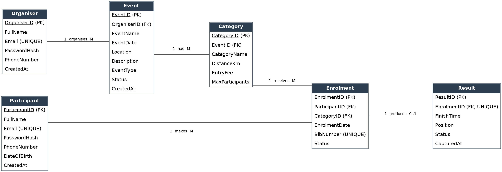

# RaceDay System

## Part 1 – System Planning, Database Design, API Planning and CI/CD

---

## 1. Project Description

RaceDay is a full-stack web-based event management system designed for the South African running, walking and cycling community.

The purpose of the system is to provide a central platform where Event Organisers can create and manage sporting events, while Participants can browse events, select categories, enrol for events and view their race results.

The system is designed around two main user roles:

- Organiser
- Participant

The database was designed to support the main activities of the RaceDay system while maintaining data integrity through primary keys, foreign keys, unique constraints, default values and check constraints.

---

## 2. System Objectives

The main objectives of the RaceDay system are to:

1. Allow Organisers to create and manage sporting events.
2. Allow Organisers to create categories for their events.
3. Allow Participants to browse available events.
4. Allow Participants to enrol in event categories.
5. Store participant enrolment information.
6. Store race results after an event has taken place.
7. Prevent invalid and duplicate database records.
8. Provide a structured database that can be accessed through a RESTful API.
9. Use GitHub for version control.
10. Use GitHub Actions to automatically validate the required Part 1 files.

---

## 3. User Roles

### 3.1 Organiser

An Organiser is responsible for creating and managing events.

The Organiser can:

- Create events
- Edit events
- Delete events
- Create event categories
- Update event categories
- Delete event categories
- View participant enrolments
- Capture participant results
- View results for events

The Organiser is linked to events through the `OrganiserID` foreign key in the `Event` table.

---

### 3.2 Participant

A Participant is a person who takes part in RaceDay events.

The Participant can:

- Create an account
- View upcoming events
- View event information
- View available categories
- Enrol in an event category
- View their enrolments
- View their race results

Participants are connected to events through the `Enrolment` table.

---

# 4. Technology Stack

| Component | Technology |
|---|---|
| Database | Microsoft SQL Server |
| Database Tool | SQL Server Management Studio (SSMS) |
| Database Language | T-SQL |
| Version Control | GitHub |
| CI/CD | GitHub Actions |
| ERD Tool | Mermaid Live Editor |
| Documentation | Microsoft Word / Markdown |

---

# 5. Database Design

The RaceDay database is called:

`RaceDayDB`

The database contains six core entities:

| Entity | Purpose |
|---|---|
| Organiser | Stores event organiser information |
| Participant | Stores participant information |
| Event | Stores RaceDay events |
| Category | Stores categories available for events |
| Enrolment | Stores participant entries into categories |
| Result | Stores participant race results |

The database follows the relationships identified in the ERD and is designed so that related information is stored separately instead of duplicating the same information across multiple tables.

---

# 6. Entity Relationship Diagram (ERD)

The ERD represents the structure of the RaceDay database and shows how the entities are connected.



### Main Relationships

| Relationship | Cardinality | Explanation |
|---|---|---|
| Organiser → Event | 1 : Many | One Organiser can manage many Events |
| Event → Category | 1 : Many | One Event can contain many Categories |
| Participant → Enrolment | 1 : Many | One Participant can have many Enrolments |
| Category → Enrolment | 1 : Many | One Category can contain many Enrolments |
| Enrolment → Result | 1 : 0..1 | An Enrolment can have zero or one Result |

### ERD Design Decisions

The `Event` table contains `OrganiserID` because every event must be associated with an organiser.

The `Category` table contains `EventID` because categories belong to a specific event.

The `Enrolment` table contains both `ParticipantID` and `CategoryID`. This connects participants to the categories they have entered and resolves the many-to-many relationship between Participants and Categories.

The `Result` table contains `EnrolmentID`. A result is associated with a specific enrolment.

The relationship between `Enrolment` and `Result` is optional because a participant can enrol before the race has taken place. Therefore, an enrolment does not necessarily have a result immediately.

---

# 7. Database Tables

## 7.1 Organiser

The `Organiser` table stores information about users who manage RaceDay events.

Important fields include:

- `OrganiserID` – Primary key
- `FullName` – Organiser's name
- `Email` – Unique email address
- `PasswordHash` – Stores the password hash
- `PhoneNumber` – Optional contact number
- `CreatedAt` – Date and time the organiser was created

---

## 7.2 Participant

The `Participant` table stores information about people who participate in RaceDay events.

Important fields include:

- `ParticipantID` – Primary key
- `FullName` – Participant's name
- `Email` – Unique email address
- `PasswordHash` – Stores the password hash
- `PhoneNumber` – Optional contact number
- `DateOfBirth` – Participant's date of birth
- `CreatedAt` – Date and time the participant was created

---

## 7.3 Event

The `Event` table stores the main information about each RaceDay event.

Important fields include:

- `EventID` – Primary key
- `OrganiserID` – Foreign key to Organiser
- `EventName` – Name of the event
- `EventDate` – Date and time of the event
- `Location` – Event location
- `Description` – Event description
- `EventType` – Running, Cycling or Walking
- `Status` – Scheduled, Cancelled or Completed
- `CreatedAt` – Date and time the event was created

---

## 7.4 Category

The `Category` table stores the different participation categories available for each event.

Important fields include:

- `CategoryID` – Primary key
- `EventID` – Foreign key to Event
- `CategoryName` – Name of the category
- `DistanceKm` – Distance of the category
- `EntryFee` – Cost of entering the category
- `MaxParticipants` – Maximum number of participants

---

## 7.5 Enrolment

The `Enrolment` table records when a participant enters an event category.

Important fields include:

- `EnrolmentID` – Primary key
- `ParticipantID` – Foreign key to Participant
- `CategoryID` – Foreign key to Category
- `EnrolmentDate` – Date of enrolment
- `BibNumber` – Unique race number
- `Status` – Pending, Confirmed or Cancelled

The combination of `ParticipantID` and `CategoryID` is unique so that the same participant cannot enrol in the same category more than once.

---

## 7.6 Result

The `Result` table stores race performance information.

Important fields include:

- `ResultID` – Primary key
- `EnrolmentID` – Foreign key to Enrolment
- `FinishTime` – Participant finish time
- `Position` – Final race position
- `Status` – Finished, DNF or DSQ
- `CapturedAt` – Date and time the result was captured

Each enrolment can have a maximum of one result.

---

# 8. Database Integrity and Constraints

Database constraints were included to ensure that incorrect or duplicate information cannot easily be inserted.

## Primary Keys

Every table has a primary key that uniquely identifies each record.

Examples:

```text
OrganiserID
ParticipantID
EventID
CategoryID
EnrolmentID
ResultID
```

---

## Part 2 – RESTful API, Authentication, Unit Testing and CI/CD

**Part 2 demo video:** _link to be added_

---

# 9. Part 2 Overview

Part 2 implements the RaceDay RESTful API planned in Part 1. The API is built with ASP.NET Core Web API (C#) and uses Entity Framework Core code-first against the `RaceDayDB` SQL Server database designed above. The entity classes and table mappings follow the Part 1 ERD and SQL script, so the table names, column names, keys and check constraints are the same.

| Component | Technology |
|---|---|
| API | ASP.NET Core Web API (.NET 8, C#) |
| Data access | Entity Framework Core 8, code-first with migrations |
| Database | Microsoft SQL Server (LocalDB by default) |
| Authentication | Server-side sessions with role-based access |
| API documentation | Swagger / OpenAPI (Swashbuckle) |
| Testing | xUnit, EF Core InMemory, ASP.NET Core test server |
| CI/CD | GitHub Actions |

---

# 10. Project Structure

```text
Part2-API/
├── RaceDay.sln
├── src/RaceDay.Api/
│   ├── Controllers/     Auth, Profile, Events, Categories, Enrolments, Results
│   ├── Models/          Organiser, Participant, Event, Category, Enrolment, Result
│   ├── Data/            RaceDayDbContext, DbInitializer (migrate + seed), Migrations
│   ├── Dtos/            Request and response objects, validation rules, mappers
│   ├── Filters/         SessionAuthorizeAttribute (401 / 403 checks)
│   ├── Services/        PasswordHasher (PBKDF2 with salt)
│   └── Program.cs       Services, session, Swagger and the request pipeline
└── tests/RaceDay.Api.Tests/
```

---

# 11. Running the API

## Requirements

- .NET 8 SDK
- SQL Server. The LocalDB instance that installs with Visual Studio works without any changes.
- Visual Studio 2022 (17.8 or later) or the `dotnet` command line

## Steps

1. Open `Part2-API/RaceDay.sln` in Visual Studio.
2. Check the connection string in `Part2-API/src/RaceDay.Api/appsettings.json`. By default it points to LocalDB:

   ```text
   Server=(localdb)\MSSQLLocalDB;Database=RaceDayDB;Trusted_Connection=True;TrustServerCertificate=True;MultipleActiveResultSets=true
   ```

   For SQL Server Express change the server part, for example `Server=localhost\SQLEXPRESS`.
3. Set `RaceDay.Api` as the startup project and press **F5**, or run it from a terminal:

   ```bash
   cd Part2-API/src/RaceDay.Api
   dotnet run --launch-profile https
   ```

4. Swagger opens at `https://localhost:7080/swagger`.

When the API starts it applies the EF Core migration (`Data/Migrations/InitialCreate`), which creates `RaceDayDB` and all six tables, and then seeds sample data. The migration can also be applied by hand with `Update-Database` in the Package Manager Console or `dotnet ef database update` from the `Part2-API` folder.

**If `RaceDayDB` was already created with the Part 1 script:** the API detects the existing tables, marks the migration as applied instead of creating the tables again, and replaces the placeholder password hashes (`HASHED_PASSWORD_1` and so on) with the demo password below. In that case only the Part 1 sample data is present. To get the full demo data, drop the database in SSMS and let the API create it.

## Seeded data

The seed data is the Part 1 sample data (2 organisers, 2 participants, 3 events, 5 categories, 4 enrolments and 2 results). The three Part 1 events have already taken place, so they are seeded as `Completed`. Two upcoming events (*Centurion Night Run* and *Cradle of Humankind Cycle Tour*) are added with dates 30 and 45 days after the database is created, so there is always an event open for enrolment.

## Demo accounts

All demo accounts use the password `Password123!`.

| Role | Email |
|---|---|
| Organiser | `thabo.mokoena@raceday.co.za` |
| Organiser | `lindiwe.nkosi@raceday.co.za` |
| Participant | `sipho.dlamini@gmail.com` |
| Participant | `anelisa.botha@gmail.com` |

## Using Swagger

1. Expand **POST /api/auth/login**, click **Try it out** and log in with one of the demo accounts.
2. The browser keeps the session cookie, so every other request made from Swagger runs as that user.
3. Call an Organiser endpoint while logged in as a Participant to see a **403**, or call a protected endpoint after **POST /api/auth/logout** to see a **401**.

Each endpoint in Swagger shows what it does, the role it needs, the request body it expects and the responses it can return.

---

# 12. Authentication and Authorisation

- **Registration** has a separate endpoint for each role, as planned in Part 1. Passwords are hashed with PBKDF2-HMAC-SHA256 (100 000 iterations and a random salt per user). Only the hash is stored in `PasswordHash`.
- **Login** checks the password hash and stores the user's ID and role in a server-side session. The browser receives an HttpOnly cookie (`.RaceDay.Session`, 60 minute idle timeout) that identifies the session on later requests.
- **`[SessionAuthorize]`** protects endpoints that need a logged-in user and returns **401** when there is no session. `[SessionAuthorize(Roles.Organiser)]` and `[SessionAuthorize(Roles.Participant)]` return **403** when the user has the wrong role.
- **Ownership checks:** an Organiser can only change their own events, categories and results, and a Participant can only cancel their own enrolments. The user ID always comes from the session and never from the request body.
- An email address can only be registered once across both tables, so a login always matches exactly one account.

---

# 13. API Endpoints

| Method | Route | Role | Success | Errors |
|---|---|---|---|---|
| POST | `/api/auth/register/organiser` | Public | 201 | 400, 409 |
| POST | `/api/auth/register/participant` | Public | 201 | 400, 409 |
| POST | `/api/auth/login` | Public | 200 | 401 |
| POST | `/api/auth/logout` | Public | 204 | – |
| GET | `/api/profile` | Any logged-in user | 200 | 401 |
| PUT | `/api/profile` | Any logged-in user | 200 | 400, 401 |
| GET | `/api/events` | Public | 200 | 400 |
| GET | `/api/events/{id}` | Public | 200 | 404 |
| POST | `/api/events` | Organiser | 201 | 400, 401, 403 |
| PUT | `/api/events/{id}` | Organiser (owner) | 200 | 400, 401, 403, 404 |
| DELETE | `/api/events/{id}` | Organiser (owner) | 204 | 401, 403, 404, 409 |
| GET | `/api/events/{eventId}/categories` | Public | 200 | 404 |
| GET | `/api/categories/{id}` | Public | 200 | 404 |
| POST | `/api/events/{eventId}/categories` | Organiser (owner) | 201 | 400, 401, 403, 404 |
| PUT | `/api/categories/{id}` | Organiser (owner) | 200 | 400, 401, 403, 404, 409 |
| DELETE | `/api/categories/{id}` | Organiser (owner) | 204 | 401, 403, 404, 409 |
| POST | `/api/categories/{id}/enrol` | Participant | 201 | 401, 403, 404, 409 |
| GET | `/api/enrolments/my` | Participant | 200 | 401, 403 |
| DELETE | `/api/enrolments/{id}` | Participant (owner) | 204 | 401, 403, 404, 409 |
| GET | `/api/events/{eventId}/enrolments` | Organiser (owner) | 200 | 401, 403, 404 |
| POST | `/api/enrolments/{id}/result` | Organiser (owner) | 201 | 400, 401, 403, 404, 409 |
| PUT | `/api/results/{id}` | Organiser (owner) | 200 | 400, 401, 403, 404 |
| GET | `/api/results/my` | Participant | 200 | 401, 403 |
| GET | `/api/events/{eventId}/results` | Public | 200 | 404 |

## Business rules

- The event type must be Running, Cycling or Walking, and a new event must have a future date.
- `GET /api/events` lists upcoming events. `?includePast=true` includes past events and `?type=Cycling` filters by type.
- A participant can enrol in a category once. Enrolment is refused (409) when the category is full, or when the event is cancelled, completed or has already taken place. Each enrolment gets a unique bib number (`BIB0001`, `BIB0002`, ...).
- Cancelling an enrolment marks it `Cancelled` and frees the place. Enrolling again in the same category re-activates it.
- Events and categories with active enrolments cannot be deleted (409), and `maxParticipants` cannot be set below the current number of enrolments (409).
- Each enrolment can have one result (409 for a second one; corrections use `PUT /api/results/{id}`). A `Finished` result needs a finish time. `DNF` and `DSQ` do not.

## Changes from the Part 1 endpoint plan

| Part 1 plan | Part 2 | Reason |
|---|---|---|
| JWT token returned on login and register | Server-side session cookie | The Part 2 brief requires session management to keep the user's authenticated state and role. Login and register return the user and role instead of a token. |
| No logout endpoint | `POST /api/auth/logout` | Needed to end a session. |
| `GET /api/events` with no options | Optional `includePast` and `type` query parameters | Lets the organiser see past events and lets participants filter by type. |
| Sample events dated September–October 2026, status `Scheduled` | Past events seeded as `Completed`, plus two upcoming events | The Part 1 dates have passed, so without this no event would be open for enrolment. |

---

# 14. Unit Testing

```bash
cd Part2-API
dotnet test
```

There are 135 automated tests. Most of them call the controllers directly against a new EF Core in-memory database for each test. `ApiPipelineTests` sends real HTTP requests through the whole API on a test server to check that the session cookie keeps users logged in.

| Area | What is tested |
|---|---|
| Registration and login | Both roles, password stored as a hash, session started, duplicate email (also across roles) returns 409, wrong password or unknown email returns 401, logout |
| Authenticated vs unauthenticated | No session returns 401 for every protected endpoint type |
| Role-based access | Participant on an Organiser endpoint returns 403 and the reverse; every restricted endpoint carries the right role and every public endpoint has none |
| Profile | Viewing and updating your own profile |
| Event management | Create, update and delete as the owner; another organiser gets 403; unknown event gets 404; delete with enrolments gets 409; invalid type, status or date gets 400 |
| Categories | Create, update and delete rules, ownership, capacity conflicts |
| Event enrolments | Enrolment recorded against the right participant, category and event, bib numbers, duplicates, full categories, closed and past events, cancel and re-enrol, organiser view |
| Results | Capture and correct as the owner, another organiser gets 403, duplicates get 409, validation, own results, public leaderboard |
| Seed data | Part 1 sample data, no duplicates on restart, demo logins, Part 1 placeholder passwords replaced |
| HTTP pipeline | Session cookie, 401, 403, logout, register-enrol-result flow end to end, every endpoint listed in Swagger |
| Validation and security | Request validation rules and password hashing |

---

# 15. CI/CD

`.github/workflows/ci.yml` runs on every push and pull request. It restores, builds (Release) and runs all the tests on .NET 8, then uploads the test results as a build artifact. The Part 1 workflow (`validate.yml`) still checks that the Part 1 documents are in the `docs` folder.
